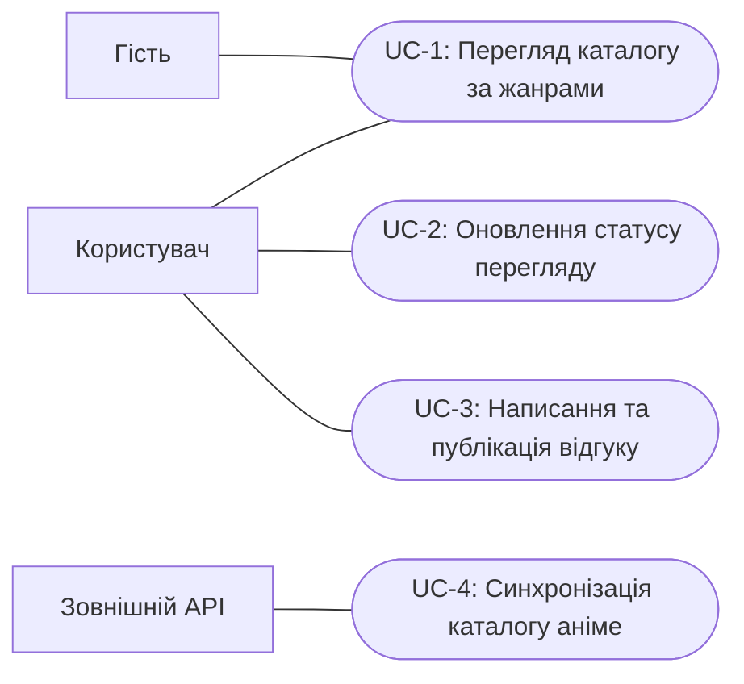
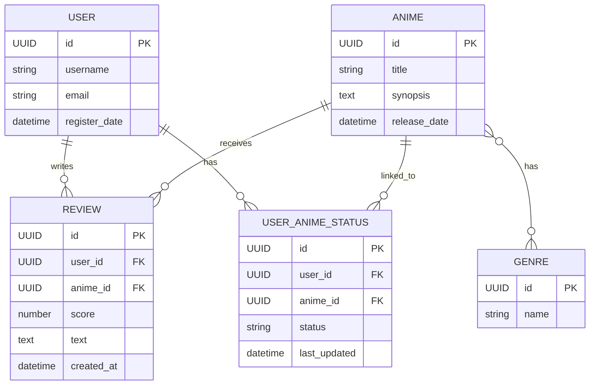

# Модель вимог та варіантів використання

## Функціональні вимоги (EARS)

| ID | Вимога |
|---|---|
| FR-1 | WHEN користувач або гість відкриває каталог аніме, система SHALL показати доступні тайтли. |
| FR-2 | WHEN користувач або гість обирає жанр у каталозі, система SHALL показати тайтли, пов'язані з цим жанром. |
| FR-3 | WHEN зареєстрований користувач змінює статус аніме в особистому списку, система SHALL зберегти один із статусів: «дивлюсь», «в планах» або «переглянуто». |
| FR-4 | IF незареєстрований гість намагається змінити статус перегляду, система SHALL відхилити дію та запропонувати увійти або зареєструватися. |
| FR-5 | WHEN зареєстрований користувач надсилає відгук про аніме з оцінкою та текстом, система SHALL опублікувати відгук, пов'язаний із цим користувачем та аніме. |
| FR-6 | IF незареєстрований гість намагається опублікувати відгук, система SHALL відхилити дію та запропонувати увійти або зареєструватися. |
| FR-7 | WHEN зовнішній API надає дані про тайтли та жанри для синхронізації, система SHALL оновити каталог аніме та жанрів відповідно до отриманих даних. |

## User stories

- **US-1 — Перегляд каталогу:** Як користувач або гість, я хочу переглядати каталог аніме за жанрами, щоб знаходити цікаві тайтли.
- **US-2 — Статус перегляду:** Як зареєстрований користувач, я хочу позначати статус перегляду аніме, щоб вести особистий список.
- **US-3 — Відгук:** Як зареєстрований користувач, я хочу оцінювати аніме та публікувати текстовий відгук, щоб ділитися своєю думкою.
- **US-4 — Актуальний каталог:** Як користувач каталогу, я хочу, щоб дані про аніме та жанри синхронізувалися із зовнішнім API, щоб каталог містив актуальну інформацію.

## Сценарії прийняття (Gherkin)

### SC-1 — Перегляд каталогу

```gherkin
Feature: Перегляд каталогу аніме

  Scenario: Користувач переглядає тайтли вибраного жанру
    Given користувач відкрив каталог аніме
    When користувач обирає жанр
    Then система показує тайтли, пов'язані з цим жанром
```

### SC-2 — Оновлення статусу перегляду

```gherkin
Feature: Особистий список перегляду

  Scenario Outline: Користувач задає статус аніме
    Given користувач увійшов у систему
    And користувач відкрив сторінку аніме
    When користувач задає статус "<status>"
    Then система зберігає цей статус в особистому списку користувача

    Examples:
      | status       |
      | дивлюсь      |
      | в планах     |
      | переглянуто  |

  Scenario: Гість намагається змінити статус
    Given гість відкрив сторінку аніме
    When гість намагається змінити статус перегляду
    Then система відхиляє дію
    And система пропонує увійти або зареєструватися
```

### SC-3 — Публікація відгуку

```gherkin
Feature: Відгуки про аніме

  Scenario: Користувач публікує відгук з оцінкою
    Given користувач увійшов у систему
    And користувач відкрив сторінку аніме
    When користувач надсилає оцінку та текст відгуку
    Then система публікує відгук
    And відгук пов'язаний із користувачем та аніме

  Scenario: Гість намагається опублікувати відгук
    Given гість відкрив сторінку аніме
    When гість намагається надіслати відгук
    Then система відхиляє публікацію
    And система пропонує увійти або зареєструватися
```

### SC-4 — Синхронізація каталогу

```gherkin
Feature: Синхронізація каталогу аніме

  Scenario: Система синхронізує тайтли та жанри із зовнішнім API
    Given зовнішній API доступний і надає дані про тайтли та жанри
    When система запускає синхронізацію каталогу
    Then система оновлює дані аніме та жанрів відповідно до відповіді API
```

## Матриця трасування

| Вимога | Use case | User story | Сценарій |
|---|---|---|---|
| FR-1 | UC-1 | US-1 | SC-1 |
| FR-2 | UC-1 | US-1 | SC-1 |
| FR-3 | UC-2 | US-2 | SC-2: Користувач задає статус аніме |
| FR-4 | UC-2 | US-2 | SC-2: Гість намагається змінити статус |
| FR-5 | UC-3 | US-3 | SC-3: Користувач публікує відгук з оцінкою |
| FR-6 | UC-3 | US-3 | SC-3: Гість намагається опублікувати відгук |
| FR-7 | UC-4 | US-4 | SC-4 |

## Діаграма варіантів використання



## ER-діаграма


