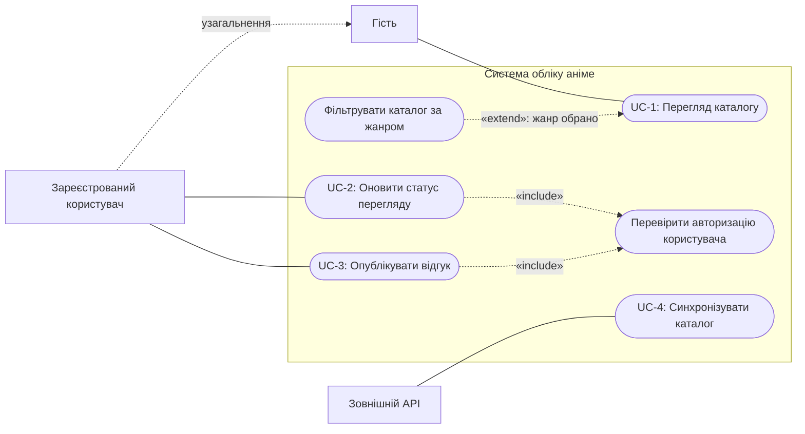
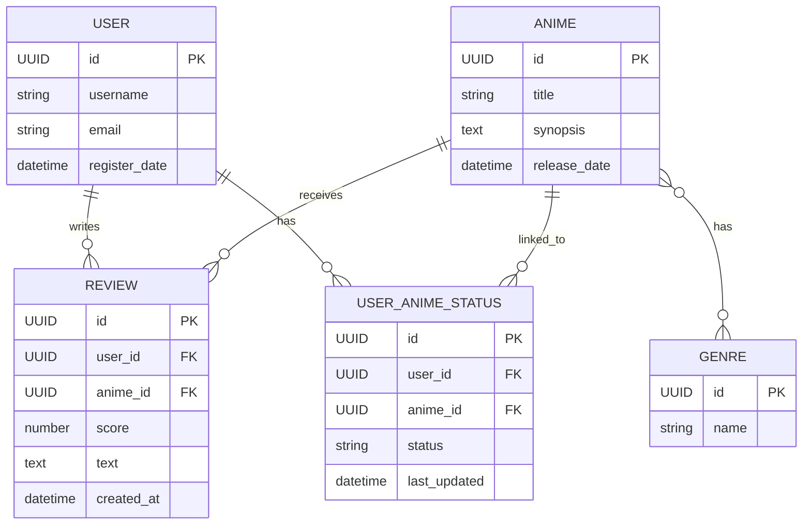

# Модель вимог та варіантів використання

## Функціональні вимоги (EARS)

| ID | Вимога |
|---|---|
| FR-1 | WHEN користувач або гість відкриває каталог, система SHALL показати записи сутності ANIME з атрибутами title, synopsis і release_date. |
| FR-2 | WHEN користувач або гість фільтрує каталог за жанром, система SHALL показати записи ANIME, пов'язані з відповідним записом GENRE через зв'язок has між ANIME і GENRE. |
| FR-3 | WHEN користувач задає статус аніме, система SHALL створити або оновити запис USER_ANIME_STATUS з атрибутами status (лише «дивлюсь», «в планах» або «переглянуто») і last_updated, пов'язаний із USER через зв'язок has та з ANIME через зв'язок linked_to. |
| FR-4 | IF гість, який не має запису USER, намагається змінити статус аніме, система SHALL відхилити дію та не створювати запис USER_ANIME_STATUS, пов'язаний із USER через зв'язок has. |
| FR-5 | WHEN користувач публікує відгук для аніме, система SHALL створити запис REVIEW з атрибутами score, text і created_at, пов'язаний із USER через зв'язок writes та з ANIME через зв'язок receives. |
| FR-6 | IF гість, який не має запису USER, намагається опублікувати відгук, система SHALL відхилити дію та не створювати запис REVIEW, пов'язаний із USER через зв'язок writes. |
| FR-7 | WHEN зовнішній API постачає дані для синхронізації, система SHALL створити або оновити записи ANIME з атрибутами title, synopsis і release_date та GENRE з атрибутом name, а також встановити між ними зв'язок has відповідно до даних API. |
| FR-8 | WHEN користувач виконує захищену дію з оновлення статусу або публікації відгуку, система SHALL перевірити наявність зареєстрованого запису USER та пов'язати створений запис USER_ANIME_STATUS або REVIEW з цим USER відповідно через зв'язок has або writes. |
| FR-9 | WHEN система надсилає email-сповіщення зареєстрованому користувачу, система SHALL використовувати адресу з атрибута email його запису USER. |

## User stories

- **US-1 — Перегляд каталогу:** Як користувач або гість, я хочу переглядати каталог аніме за жанрами, щоб знаходити цікаві тайтли.
- **US-2 — Статус перегляду:** Як зареєстрований користувач, я хочу позначати статус перегляду аніме, щоб вести особистий список.
- **US-3 — Відгук:** Як зареєстрований користувач, я хочу оцінювати аніме та публікувати текстовий відгук, щоб ділитися своєю думкою.
- **US-4 — Актуальний каталог:** Як користувач каталогу, я хочу, щоб дані про аніме та жанри синхронізувалися із зовнішнім API, щоб каталог містив актуальну інформацію.

## Сценарії прийняття (Gherkin)

### SC-1 — Перегляд каталогу

```gherkin
Feature: Перегляд каталогу аніме

  Scenario: Користувач переглядає каталог
    Given користувач відкрив каталог аніме
    When каталог завантажується
    Then система показує записи ANIME з атрибутами title, synopsis і release_date

  Scenario: Користувач переглядає тайтли вибраного жанру
    Given користувач відкрив каталог аніме
    When користувач обирає жанр
    Then система показує записи ANIME, пов'язані з вибраним записом GENRE через зв'язок has
```

### SC-2 — Оновлення статусу перегляду

```gherkin
Feature: Особистий список перегляду

  Scenario Outline: Користувач задає статус аніме
    Given користувач увійшов у систему
    And користувач відкрив сторінку аніме
    When користувач задає статус "<status>"
    Then система створює або оновлює запис USER_ANIME_STATUS зі статусом "<status>"
    And запис пов'язаний із користувачем через USER
    And запис пов'язаний із тайтлом через ANIME

    Examples:
      | status       |
      | дивлюсь      |
      | в планах     |
      | переглянуто  |

  Scenario: Гість намагається змінити статус
    Given гість відкрив сторінку аніме
    When гість намагається змінити статус перегляду
    Then система відхиляє дію
    And система не створює запис USER_ANIME_STATUS без пов'язаного USER
```

### SC-3 — Публікація відгуку

```gherkin
Feature: Відгуки про аніме

  Scenario: Користувач публікує відгук з оцінкою
    Given користувач увійшов у систему
    And користувач відкрив сторінку аніме
    When користувач надсилає оцінку та текст відгуку
    Then система створює запис REVIEW з оцінкою score та текстом text
    And REVIEW пов'язаний із USER зв'язком writes
    And REVIEW пов'язаний із ANIME зв'язком receives

  Scenario: Гість намагається опублікувати відгук
    Given гість відкрив сторінку аніме
    When гість намагається надіслати відгук
    Then система відхиляє публікацію
    And система не створює запис REVIEW без пов'язаного USER
```

### SC-4 — Синхронізація каталогу

```gherkin
Feature: Синхронізація каталогу аніме

  Scenario: Система синхронізує тайтли та жанри із зовнішнім API
    Given зовнішній API доступний і надає дані про тайтли та жанри
    When система запускає синхронізацію каталогу
    Then система створює або оновлює ANIME з атрибутами title, synopsis і release_date
    And система створює або оновлює GENRE з атрибутом name
    And система встановлює зв'язок has між відповідними записами ANIME і GENRE
```

## Матриця трасування

Один use case може реалізовувати кілька вимог, а спільна вимога може стосуватися кількох use case-ів. Рядки з FR-8 показують зв'язок M:N для спільної перевірки авторизації. FR-9 навмисно лишається непокритою: email-сповіщення не входять до описаних user stories, use case-ів або сценаріїв і потребують окремого визначення подій сповіщення.

| Вимога | Use case | User story | Сценарій / покриття |
|---|---|---|---|
| FR-1 | UC-1 | US-1 | SC-1: Користувач переглядає каталог |
| FR-2 | UC-1 | US-1 | SC-1: Користувач переглядає тайлти вибраного жанру |
| FR-3 | UC-2 | US-2 | SC-2: Користувач задає статус аніме |
| FR-4 | UC-2 | US-2 | SC-2: Гість намагається змінити статус |
| FR-8 | UC-2 | US-2 | SC-2: Користувач задає статус аніме |
| FR-5 | UC-3 | US-3 | SC-3: Користувач публікує відгук з оцінкою |
| FR-6 | UC-3 | US-3 | SC-3: Гість намагається опублікувати відгук |
| FR-8 | UC-3 | US-3 | SC-3: Користувач публікує відгук з оцінкою |
| FR-7 | UC-4 | US-4 | SC-4 |
| FR-9 | — | — | Непокрита вимога (out-of-scope): не визначені подія сповіщення та відповідний use case |

## Діаграма варіантів використання

Зв'язок узагальнення спрямований від спеціалізованого актора `User` до базового `Guest`: зареєстрований користувач успадковує можливість перегляду каталогу. Стрілка `<<include>>` спрямована від основного use case до спільної обов'язкової поведінки; `<<extend>>` — від умовного розширення до базового use case.



## ER-діаграма


