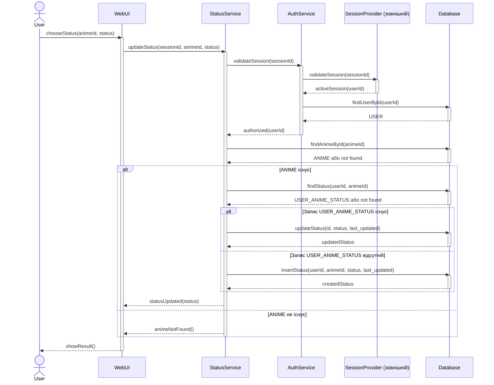

# Sequence-діаграми UC-2: Оновити статус перегляду

Діаграми деталізують взаємодію для зареєстрованого користувача та гостя.

**Припущення:** перевірка активної сесії виконується через зовнішній механізм `SessionProvider`, якого немає в ER-моделі. Для пари `user_id` + `anime_id` існує не більше одного запису `USER_ANIME_STATUS`. Перед зміною статусу перевіряється наявність запису `ANIME`.

## Сценарій 1: Зареєстрований користувач задає статус аніме



## Сценарій 2: Гість намагається змінити статус перегляду

```mermaid
sequenceDiagram
    actor Guest
    participant WebUI
    participant StatusService
    participant AuthService
    participant SessionProvider as SessionProvider (зовнішній)
    participant Database

    Guest->>WebUI: chooseStatus(animeId, status)
    activate WebUI
    WebUI->>StatusService: updateStatus(sessionId, animeId, status)
    activate StatusService
    StatusService->>AuthService: validateSession(sessionId)
    activate AuthService
    AuthService->>SessionProvider: validateSession(sessionId)
    activate SessionProvider
    SessionProvider-->>AuthService: activeSession(userId) або inactiveSession
    deactivate SessionProvider
    alt Активної сесії немає
        AuthService-->>StatusService: unauthorized
        deactivate AuthService
        StatusService-->>WebUI: statusChangeRejected()
        Note right of StatusService: USER_ANIME_STATUS не читається і не змінюється
        WebUI-->>Guest: promptSignInOrRegister()
    else Сесія активна
        AuthService->>Database: findUserById(userId)
        activate Database
        Database-->>AuthService: USER або not found
        deactivate Database
        alt Запис USER існує
            AuthService-->>StatusService: authorized(userId)
            deactivate AuthService
            Note over StatusService,Database: Це авторизований користувач; продовження відповідає сценарію 1
            StatusService-->>WebUI: continueAsAuthenticatedUser()
        else Запис USER відсутній
            AuthService-->>StatusService: unauthorized
            deactivate AuthService
            StatusService-->>WebUI: statusChangeRejected()
            Note right of StatusService: USER_ANIME_STATUS не читається і не змінюється
            WebUI-->>Guest: promptSignInOrRegister()
        end
    end
    deactivate StatusService
    deactivate WebUI
```
